# OpsInsight

**A Full-Stack IT Operations and Incident Management Dashboard**

OpsInsight is a full-stack web application designed to provide a centralised view of IT service health, incident management, user permissions and assignment workflows.

The project was developed to demonstrate practical full-stack software development, API integration, database design, authentication and role-based access control.

## Application Preview

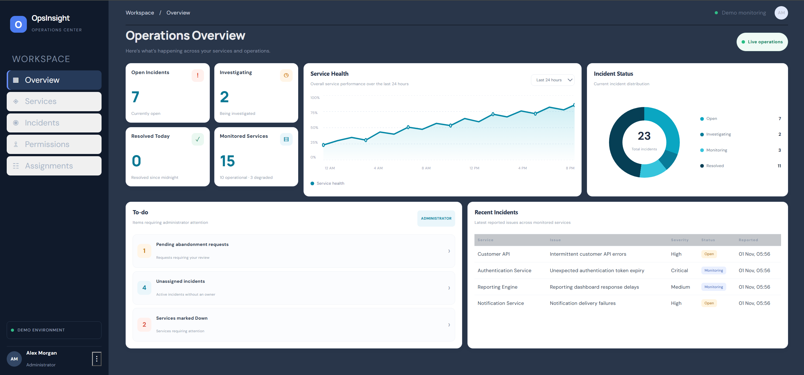

## Features

### Operations Dashboard
- Centralised overview of service health and incident activity.
- Summary cards displaying key operational indicators.
- Visual service health trends and incident breakdowns.

### Service Monitoring
- View registered services and their operational status.
- Monitor uptime percentages and response times.
- Identify services experiencing degraded performance or outages.

### Incident Management
- Create and manage incident records.
- Track incident severity and status.
- Update incident progress through its lifecycle.
- View incident details and associated service information.

### Assignment Management
- Assign incidents to individual users.
- Track active and historical assignments.
- Maintain assignment ownership and reassignment history.
- Support assignment abandonment requests and administrator review.

### User Management and Permissions
- Authenticated user access.
- Administrator and Contributor permission levels.
- User management and permission updates.
- Role-based restrictions on application actions.

## Technology Stack

| Area | Technologies |
|---|---|
| Frontend | React, TypeScript |
| Styling | CSS |
| Build Tool | Vite |
| Backend | ASP.NET Core Web API |
| Language | C# |
| Database | Microsoft SQL Server |
| ORM | Entity Framework Core |
| Authentication | Cookie-based authentication |
| API | REST endpoints |

## Architecture

OpsInsight uses a separate frontend and backend, with the API communicating with SQL Server through Entity Framework Core.

```text
React + TypeScript
       |
       | HTTP requests
       v
ASP.NET Core Web API
       |
       | Entity Framework Core
       v
Microsoft SQL Server
```

The frontend is responsible for the user interface and application interactions. The backend handles API requests, authentication, authorisation and database operations.

## Screenshots

### Login
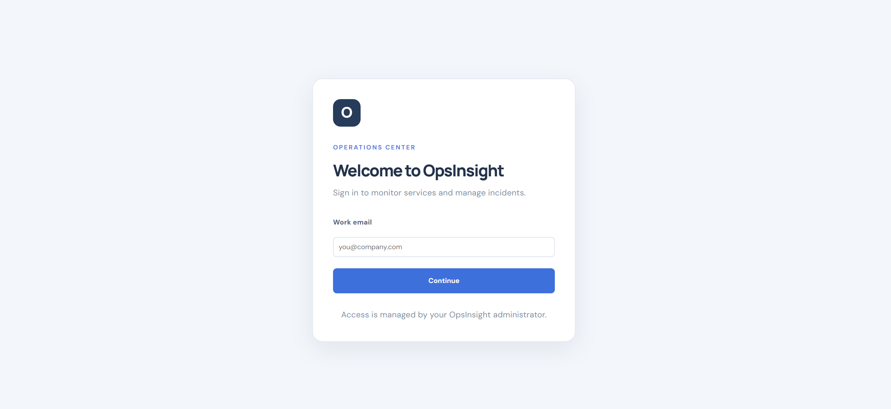

### Overview

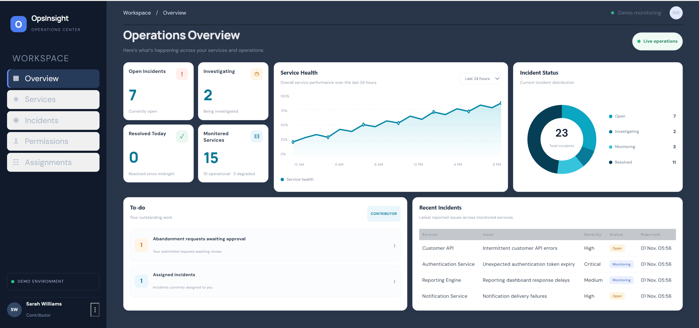

### Services
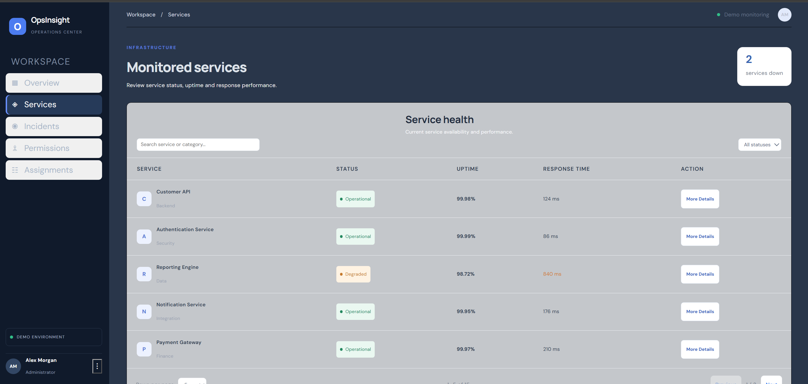
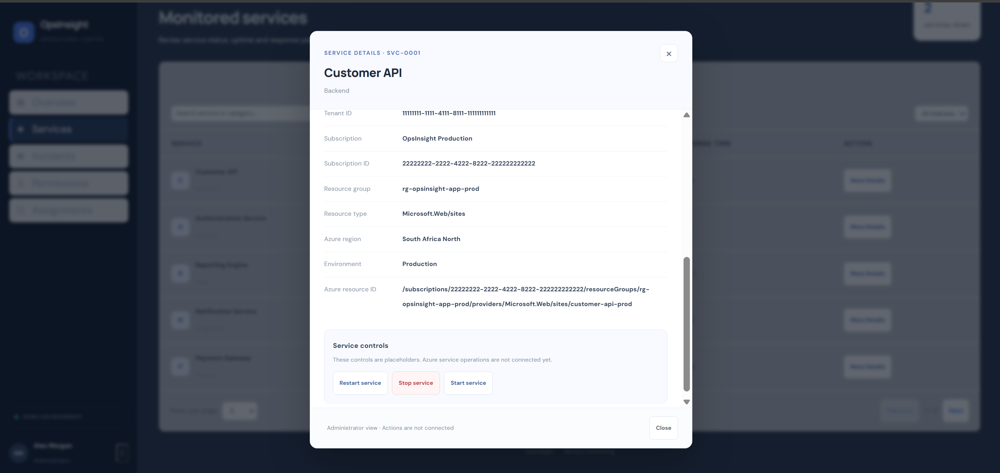

### Incidents
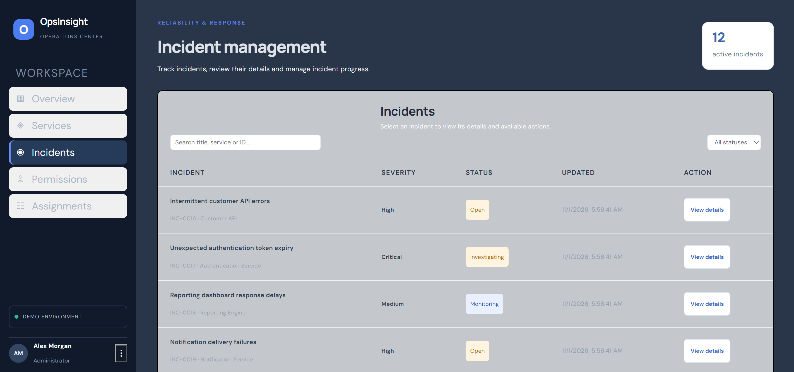
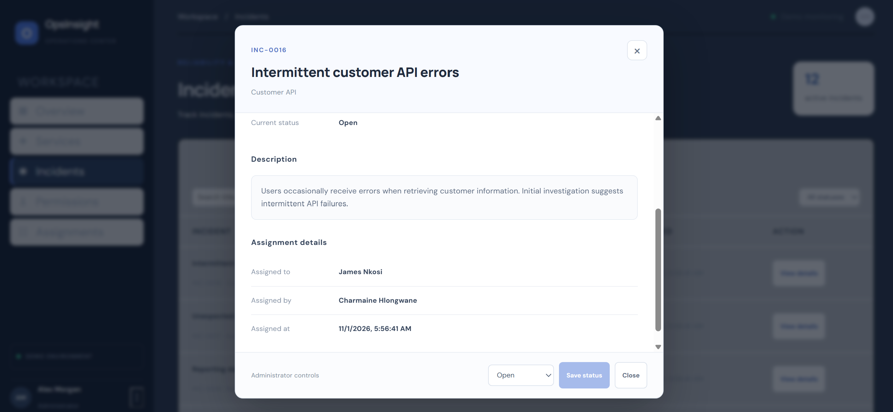

### Assignments
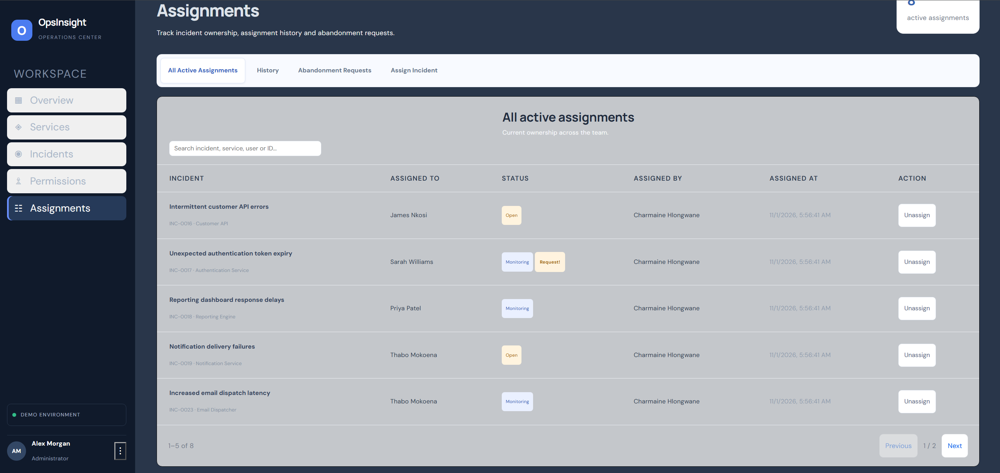
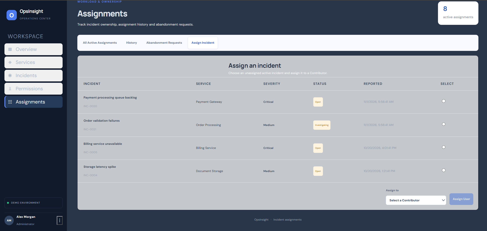
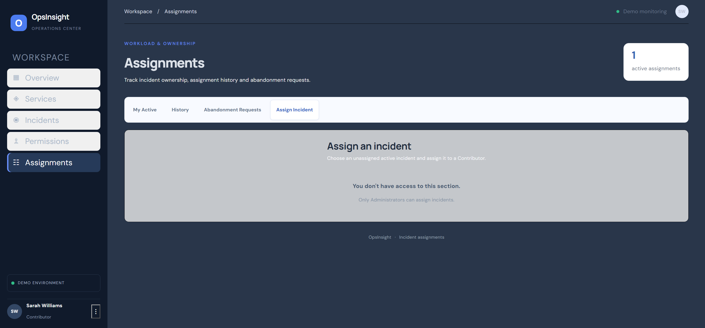
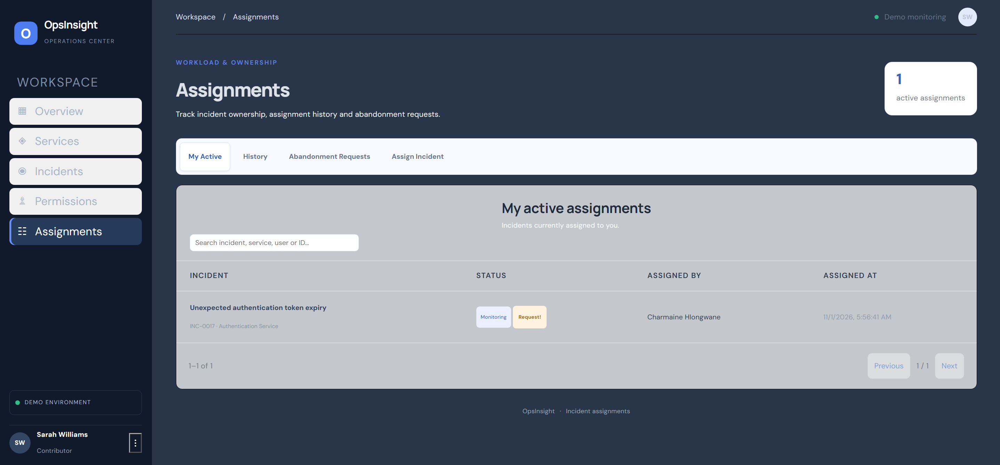
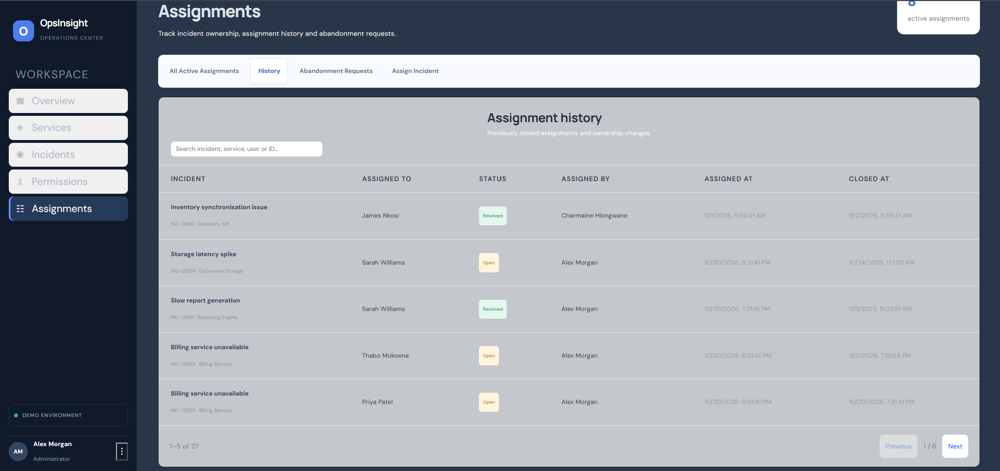
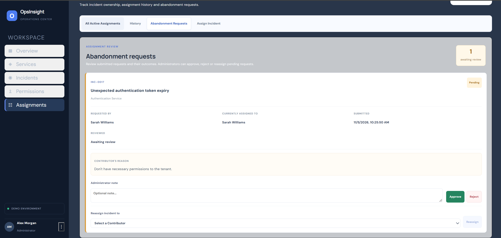

### Permissions
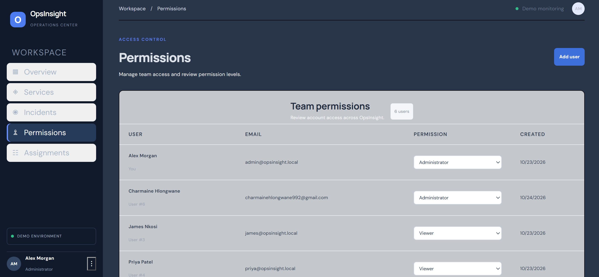

## Getting Started

To run OpsInsight locally, you will need:

- .NET 10 SDK
- Node.js and npm
- Microsoft SQL Server
- SQL Server Management Studio (recommended)

### 1. Clone the repository

```bash
git clone https://github.com/charmainePWD/OpsInsight.git
cd OpsInsight
```

### 2. Configure the database

Follow the instructions in [`database/README.md`](database/README.md).

Run the database scripts in this order:

1. `database/schema.sql`
2. `database/seed-data.sql`

### 3. Configure the API

Follow [`OpsInsight.Api/README.md`](OpsInsight.Api/README.md) to configure the SQL Server connection string and start the API.

### 4. Configure the frontend

Follow [`opsinsight-web/README.md`](opsinsight-web/README.md) to install dependencies and configure the API URL.

## Demo Accounts

The database seed script provides demonstration accounts.

| Role | Email |
|---|---|
| Administrator | admin@opsinsight.demo |
| Contributor | sam.taylor@opsinsight.demo |
| Contributor | jordan.lee@opsinsight.demo |
| Contributor | priya.naidoo@opsinsight.demo |

**Password for all demo accounts:** `OpsInsightDemo!2026`

These credentials are intended for local demonstration purposes only.

## Project Structure

```text
OpsInsight/
├── OpsInsight.Api/       # ASP.NET Core backend
├── opsinsight-web/       # React frontend
├── database/             # SQL schema and sample data
├── screenshots/          # Application screenshots
└── README.md
```

## Project Status

OpsInsight is an ongoing independent development project. Its functionality and documentation may continue to evolve as additional features, refinements and improvements are introduced.
